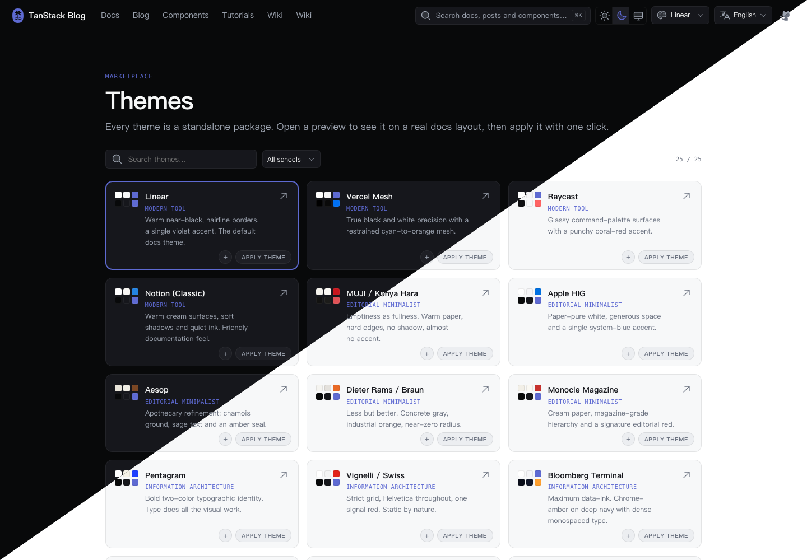
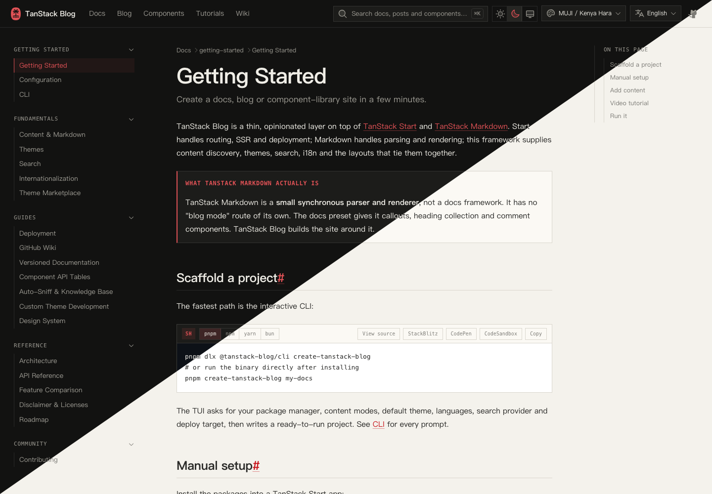
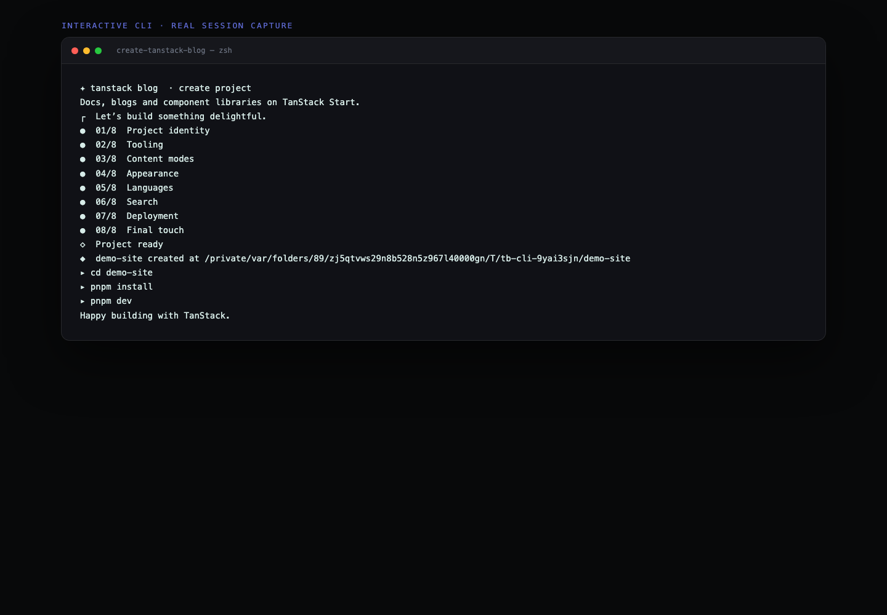
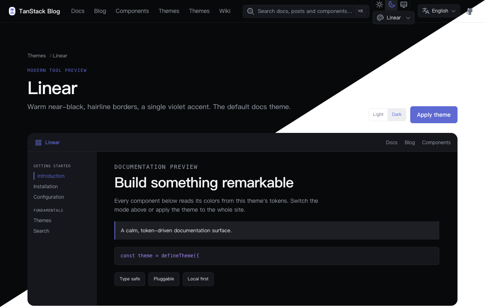

<div align="center">

# TanStack Blog

[English](./README.md) · [简体中文](./README.zh-CN.md)

**Live demo:** https://tanstack-blog.jiangjiangjiangxi.workers.dev

**Docs, blogs and component libraries — one pluggable framework on TanStack Start.**

[](./LICENSE)
[](https://tanstack.com/start/latest)
[](https://tanstack-blog.jiangjiangjiangxi.workers.dev)

</div>

TanStack Blog is a theme-driven documentation framework built on **[TanStack Start](https://tanstack.com/start/latest)**, **[TanStack Router](https://tanstack.com/router/latest)** and **[TanStack Markdown](https://tanstack.com/markdown/latest)**. It supplies content discovery, a 25-theme marketplace, offline search, i18n, versioned docs, an LLM-free knowledge base and a polished TUI scaffolder without taking control of your stack.

> TanStack Markdown is a small parser/renderer, not a site generator. This project provides the site layer around it.

## Screenshots

Every screenshot is a real capture of both color modes, split diagonally: **dark in the upper-left triangle, light in the lower-right**.

| Documentation (default Linear theme) | Theme marketplace |
| --- | --- |
|  |  |

| MUJI editorial theme | Command-palette search |
| --- | --- |
|  |  |

| Interactive CLI scaffolder | Per-theme preview |
| --- | --- |
|  |  |

> Screenshots come from the real app and CLI. After starting the dev server, run `pnpm screenshot` and `pnpm screenshot:cli`. All 25 themes have their own preview in `docs/screenshots/themes/`.

## Feature highlights

- **Three content modes** — docs trees, reverse-chronological blogs, component galleries.
- **Build-time Markdown** — TanStack Markdown + docs preset + TanStack Highlight; no parser in the browser.
- **25 theme presets** with live previews, side-by-side comparison, token tables, CSS export, a live editor and one standalone plugin package per preset. Runtime switching never remounts React.
- **Search adapters** — Orama, dependency-free local, and optional Algolia; `⌘K` palette with highlighting, section filters and recent queries.
- **i18n** — locale-prefixed routes, six built-in dictionaries, RTL-ready layout, hreflang links, locale persistence.
- **Versioned docs** — frozen versions under `content/<version>/<locale>/` with a header switcher.
- **Dumi-style slots** — override any site component through a typed `ThemeSlots` registry; TSDoc-generated props tables for component docs.
- **LLM-free knowledge base** — static analysis generates overview/architecture/api/dependencies/glossary pages at `/wiki/*`.
- **SEO & a11y** — sitemap, RSS, llms.txt, llms-full.txt, robots.txt, skip link, heading copy links.
- **Deploy anywhere** — Cloudflare Workers, Vercel, Netlify, Node, Docker and other Nitro presets.
- **GitHub Wiki ready** — `pnpm wiki:sync` mirrors every page as plain Markdown.
- **Interactive scaffolder** — Clack TUI plus `sniff`, `kb`, `create-theme` and `run` utilities.

## Quick start

```sh
pnpm dlx @tanstack-blog/cli          # interactive TUI
pnpm dlx @tanstack-blog/cli sniff .  # auto-detect an existing repo

# work on this repository
pnpm install
pnpm build:packages
pnpm dev                             # http://localhost:3000
```

The `apps/docs` app is both the full demo and the complete documentation. Start with the [5-step tutorial track](./apps/docs/content/en/tutorials/01-quickstart.md).

## Packages

| Package | Purpose |
| --- | --- |
| `@tanstack-blog/core` | Config schema, content pipeline, i18n, theme contract, Vite plugin, build-time outputs |
| `@tanstack-blog/ui` | React layouts, slot registry, theme provider, search palette, code blocks, icons, CSS |
| `@tanstack-blog/search` | Shared search adapter contract + local matcher |
| `@tanstack-blog/orama-search` | Orama full-text adapter |
| `@tanstack-blog/algolia-search` | Optional Algolia adapter |
| `@tanstack-blog/kb` | LLM-free project sniffing and knowledge-base generator |
| `@tanstack-blog/themes` | 25 token presets, registry and localization helpers |
| `@tanstack-blog/theme-*` | One installable plugin package per preset (25 packages) |
| `@tanstack-blog/cli` | `create-tanstack-blog` TUI and maintenance commands |

## Commands

```sh
pnpm dev                 # docs dev server
pnpm build               # all packages + docs
pnpm build:packages      # libraries only
pnpm check               # Biome lint + format
pnpm test                # package tests
pnpm test:e2e            # 80+ feature checks across 5 suites
pnpm test:visual         # 50 theme/viewport screenshot baselines
pnpm test:visual:update  # refresh baselines after intentional UI changes
pnpm wiki:sync           # regenerate the GitHub Wiki mirror
pnpm screenshot          # regenerate all diagonal screenshots
pnpm screenshot:cli      # capture a real CLI session
pnpm video:record        # record real CLI sessions to MP4
pnpm api:generate        # TSDoc -> props tables
pnpm registry:generate   # regenerate theme registry
pnpm kb:generate         # regenerate the knowledge base
pnpm exec create-tanstack-blog doctor   # project health check
pnpm exec create-tanstack-blog hooks all # generate lefthook/husky/lint-staged hooks
pnpm deploy:cloudflare   # deploy via Nitro
```

All maintenance scripts are also available through the CLI, e.g. `pnpm exec create-tanstack-blog run api`.

## Documentation index

**Basics:** [Getting Started](./apps/docs/content/en/docs/getting-started.md) · [Configuration](./apps/docs/content/en/docs/configuration.md) · [Content & Markdown](./apps/docs/content/en/docs/content-and-markdown.md) · [CLI](./apps/docs/content/en/docs/cli.md)

**Themes:** [Themes](./apps/docs/content/en/docs/themes.md) · [Theme Marketplace](./apps/docs/content/en/docs/theme-marketplace.md) · [Custom Theme Development](./apps/docs/content/en/docs/theme-customization.md) · [Design System](./apps/docs/content/en/docs/design-system.md)

**Features:** [Search](./apps/docs/content/en/docs/search.md) · [Internationalization](./apps/docs/content/en/docs/i18n.md) · [Versioned Documentation](./apps/docs/content/en/docs/versioning.md) · [Component API Tables](./apps/docs/content/en/docs/component-api.md) · [Auto-Sniff & Knowledge Base](./apps/docs/content/en/docs/auto-kb.md)

**Operations:** [Deployment](./apps/docs/content/en/docs/deployment.md) · [GitHub Wiki](./apps/docs/content/en/docs/github-wiki.md) · [Architecture](./apps/docs/content/en/docs/architecture.md) · [API Reference](./apps/docs/content/en/docs/api-reference.md)

**Project:** [Contributing](./apps/docs/content/en/docs/contributing.md) · [Feature Comparison](./apps/docs/content/en/docs/comparison.md) · [Roadmap](./apps/docs/content/en/docs/roadmap.md) · [Disclaimer & Licenses](./apps/docs/content/en/docs/disclaimer.md)

Every page has a Simplified Chinese counterpart under `apps/docs/content/zh-CN/`.

## Video tutorials

Real CLI session recordings live at `/videos`, with MP4 assets under `apps/docs/public/videos/`. They are captured from a live pseudo-terminal and encoded with ffmpeg (`scripts/record-cli-video.mjs`).

## Disclaimer

This is an independent community project and is not an official TanStack product. See [Disclaimer & Licenses](./apps/docs/content/en/docs/disclaimer.md) and [THIRD_PARTY_NOTICES.md](./THIRD_PARTY_NOTICES.md) for the dependency and license inventory.
