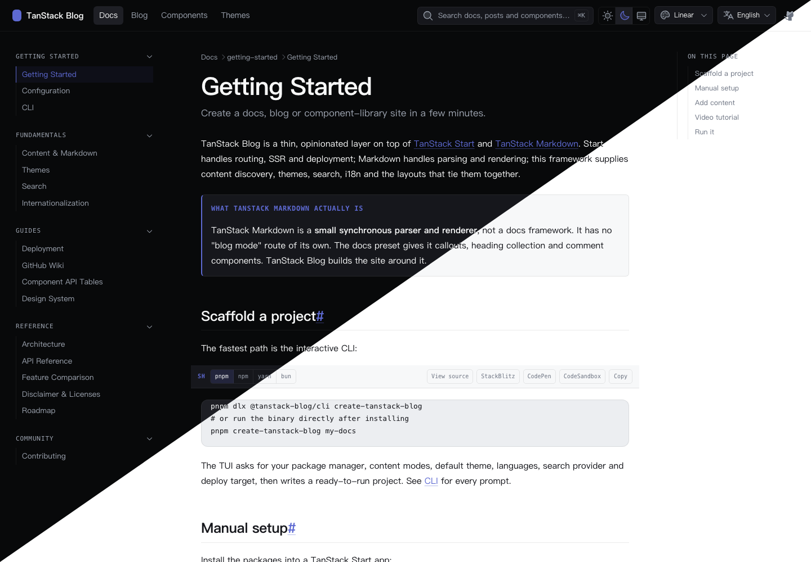
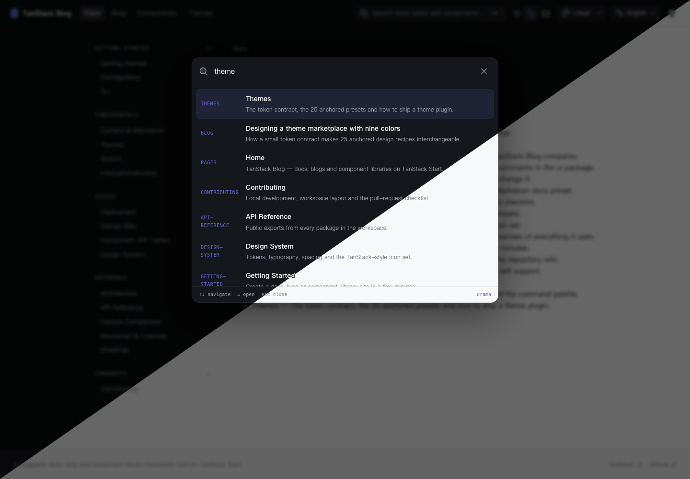

<div align="center">

# TanStack Blog

[English](./README.md) · [简体中文](./README.zh-CN.md)

**Live demo:** https://tanstack-blog.jiangjiangjiangxi.workers.dev

**Docs, blogs and component libraries — one pluggable framework on TanStack Start.**

[](./LICENSE)
[](https://tanstack.com/start/latest)

</div>

TanStack Blog is a theme-driven documentation framework built on **[TanStack Start](https://tanstack.com/start/latest)**, **[TanStack Router](https://tanstack.com/router/latest)** and **[TanStack Markdown](https://tanstack.com/markdown/latest)**. It gives you content discovery, 25 swappable themes, offline search, i18n and a polished TUI scaffolder without taking control of your stack.

> TanStack Markdown is a parser/renderer, not a site generator. This project provides the site layer around it.

## Screenshots

Every screenshot is a real capture of both color modes, split diagonally: **dark in the upper-left triangle, light in the lower-right**.

| Documentation (default Linear theme) | Theme marketplace |
| --- | --- |
|  |  |

| MUJI editorial theme | Command-palette search |
| --- | --- |
|  |  |

| Interactive CLI scaffolder | Docs UI and theme marketplace |
| --- | --- |
|  |  |

> Screenshots are captured from the real app and CLI. Start the dev server, then run `pnpm screenshot` and `pnpm screenshot:cli` to regenerate them. Every theme also has its own preview screenshot in `docs/screenshots/themes/`.

## Features

- **Three content modes** — documentation trees, reverse-chronological blogs, and component galleries.
- **Build-time Markdown** — parsed once with TanStack Markdown + its docs preset, highlighted with TanStack Highlight; no parser in the browser.
- **25 theme presets** translated from the `web-design-engineer` recipe catalog, with three standalone plugin packages and runtime switching that never remounts React.
- **Search** — Orama full-text index or a zero-dependency local matcher, configurable and keyboard-driven (`⌘K`).
- **i18n** — locale-prefixed routes, overridable dictionaries, RTL-ready layout, English and Simplified Chinese built in.
- **TanStack-native** — Router for navigation, Start for SSR and deploy, Store for UI state, Devtools-ready.
- **Zero route manifests** — a single catch-all route maps paths to Markdown files.
- **Deploy anywhere** — Cloudflare, Vercel, Netlify, Node, Docker and other Nitro presets.
- **GitHub wiki ready** — `pnpm wiki:sync` mirrors every page as plain Markdown.
- **Interactive scaffolder** — a Clack TUI that asks for the six decisions that matter and writes a complete project.

## Quick start

```sh
# Interactive scaffolder
pnpm dlx @tanstack-blog/cli

# or work on this repository
pnpm install
pnpm build:packages
pnpm dev                 # http://localhost:3000
```

The repository's `apps/docs` app is the full demo and the complete documentation. Start at [Getting Started](./apps/docs/content/en/docs/getting-started.md).

## Packages

| Package | Purpose |
| --- | --- |
| `@tanstack-blog/core` | Config schema, content pipeline, i18n, theme contract, Vite plugin, search |
| `@tanstack-blog/ui` | React layouts, theme provider, search dialog, icon set, base CSS |
| `@tanstack-blog/themes` | All 25 token presets |
| `@tanstack-blog/theme-linear` | Default docs theme plugin |
| `@tanstack-blog/theme-muji` | Quiet editorial theme plugin |
| `@tanstack-blog/theme-stripe` | Warm editorial theme plugin |
| `@tanstack-blog/cli` | `create-tanstack-blog` TUI scaffolder |

## Commands

```sh
pnpm dev                 # docs dev server
pnpm build               # packages + docs
pnpm build:packages      # libraries only
pnpm check               # Biome lint + format
pnpm test                # package tests
pnpm wiki:sync           # regenerate the wiki mirror
pnpm deploy:cloudflare   # deploy via Nitro
```

## Video tutorials

Real CLI session recordings are available at `/videos`, with MP4 assets under `apps/docs/public/videos/`. They are captured from a live pseudo-terminal and encoded with ffmpeg; see `scripts/record-cli-video.mjs`.

## Documentation index

- [Getting Started](./apps/docs/content/en/docs/getting-started.md)
- [Configuration](./apps/docs/content/en/docs/configuration.md)
- [Content & Markdown](./apps/docs/content/en/docs/content-and-markdown.md)
- [Themes](./apps/docs/content/en/docs/themes.md)
- [Search](./apps/docs/content/en/docs/search.md)
- [Internationalization](./apps/docs/content/en/docs/i18n.md)
- [Deployment](./apps/docs/content/en/docs/deployment.md)
- [CLI](./apps/docs/content/en/docs/cli.md)
- [Architecture](./apps/docs/content/en/docs/architecture.md)
- [API Reference](./apps/docs/content/en/docs/api-reference.md)
- [Design System](./apps/docs/content/en/docs/design-system.md)
- [GitHub Wiki](./apps/docs/content/en/docs/github-wiki.md)
- [Contributing](./apps/docs/content/en/docs/contributing.md)
- [Disclaimer & Licenses](./apps/docs/content/en/docs/disclaimer.md)
- [Feature Comparison](./apps/docs/content/en/docs/comparison.md)
- [Roadmap](./apps/docs/content/en/docs/roadmap.md)

## Disclaimer

This is an independent community project and is not an official TanStack product. See [Disclaimer & Licenses](./apps/docs/content/en/docs/disclaimer.md) and [THIRD_PARTY_NOTICES.md](./THIRD_PARTY_NOTICES.md) for the full inventory of dependencies and their licenses.
