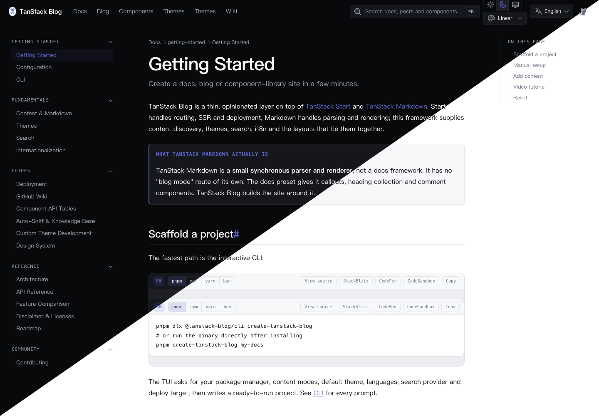
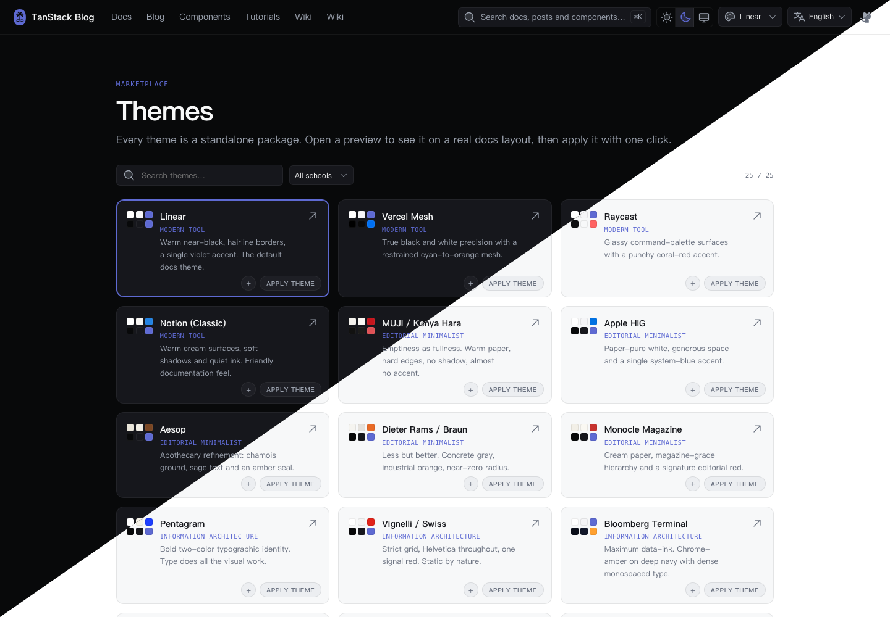
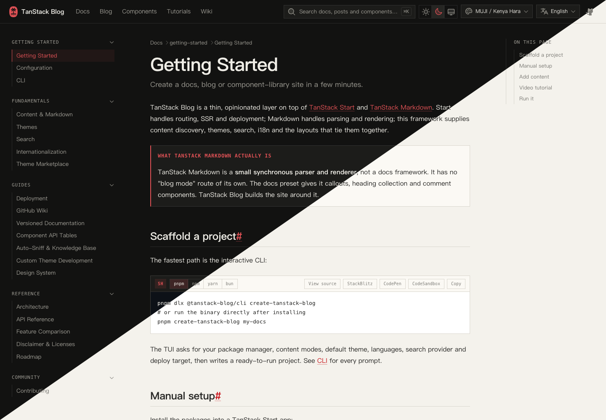
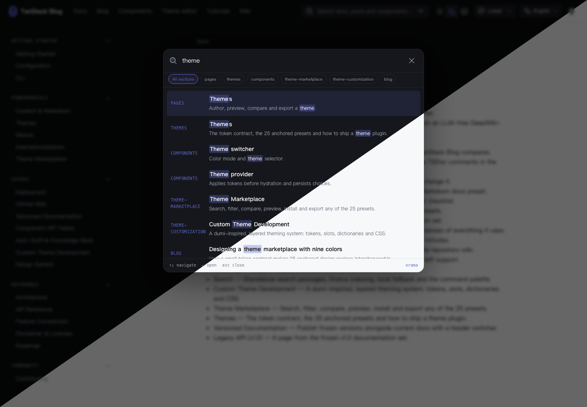
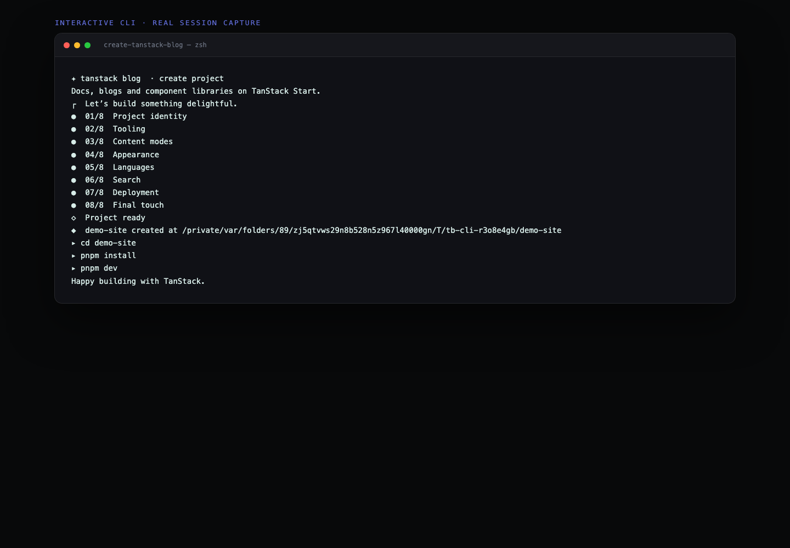
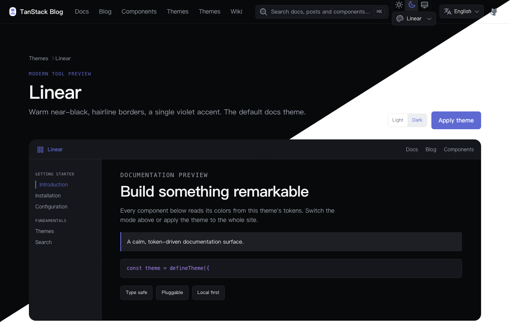

<div align="center">

# TanStack Blog

[English](./README.md) · 简体中文

**在线演示：** https://tanstack-blog.jiangjiangjiangxi.workers.dev

**文档、博客与组件库——基于 TanStack Start 的可插拔框架。**

[](./LICENSE)
[](https://tanstack.com/start/latest)

</div>

TanStack Blog 是基于 **[TanStack Start](https://tanstack.com/start/latest)**、**[TanStack Router](https://tanstack.com/router/latest)** 与 **[TanStack Markdown](https://tanstack.com/markdown/latest)** 的主题驱动文档框架。它提供内容发现、25 套主题市场、离线搜索、多语言、版本化文档、无 LLM 知识库与交互式脚手架，同时不接管你的技术栈。

> TanStack Markdown 是小型解析器/渲染器，不是站点生成器；站点层由本项目提供。

## 截图

每张截图都是真实捕获的明暗两种主题，沿对角线拼接：**左上为暗色，右下为亮色**。

| 文档站（默认 Linear 主题） | 主题市场 |
| --- | --- |
|  |  |

| MUJI 编辑风格主题 | 命令面板搜索 |
| --- | --- |
|  |  |

| 交互式 CLI 脚手架 | 单主题预览 |
| --- | --- |
|  |  |

> 截图来自真实应用与 CLI。启动开发服务器后运行 `pnpm screenshot` 与 `pnpm screenshot:cli`。25 套主题均有独立预览图，见 `docs/screenshots/themes/`。

## 核心能力

- **三种内容模式** —— 文档树、按时间倒序的博客、组件画廊。
- **构建期 Markdown** —— TanStack Markdown + 文档预设 + TanStack Highlight，浏览器无解析器。
- **25 套主题预设** —— 实时预览、并排对比、令牌表、CSS 导出、实时编辑器；每套都有独立插件包。切换不重挂载 React。
- **搜索适配器** —— Orama、零依赖本地、可选 Algolia；`⌘K` 面板支持高亮、板块筛选与最近查询。
- **国际化** —— 语言前缀路由、六套内置字典、RTL 布局、hreflang、语言持久化。
- **文档版本** —— `content/<version>/<locale>/` 下的冻结版本与顶部版本切换器。
- **dumi 式插槽** —— 通过类型化 `ThemeSlots` 覆盖任意站点组件；TSDoc 生成组件属性表。
- **无 LLM 知识库** —— 静态分析生成 `/wiki/*` 的概览/架构/API/依赖/术语表。
- **SEO 与无障碍** —— sitemap、RSS、llms.txt、llms-full.txt、robots.txt、跳转链接、标题复制链接。
- **随处部署** —— Cloudflare Workers、Vercel、Netlify、Node、Docker 与其他 Nitro 预设。
- **GitHub Wiki 友好** —— `pnpm wiki:sync` 将每页镜像为纯 Markdown。
- **交互式脚手架** —— Clack TUI，外加 `sniff`、`kb`、`create-theme`、`run` 工具命令。

## 快速开始

```sh
pnpm dlx @tanstack-blog/cli          # 交互式 TUI
pnpm dlx @tanstack-blog/cli sniff .  # 自动嗅探已有仓库

# 在本仓库开发
pnpm install
pnpm build:packages
pnpm dev                             # http://localhost:3000
```

`apps/docs` 既是完整演示，也是完整文档。从[五步教程](./apps/docs/content/zh-CN/tutorials/01-quickstart.md)开始。

## 包

| 包 | 用途 |
| --- | --- |
| `@tanstack-blog/core` | 配置 schema、内容管线、i18n、主题契约、Vite 插件、构建产物 |
| `@tanstack-blog/ui` | React 布局、插槽注册表、主题 Provider、搜索面板、代码块、图标、CSS |
| `@tanstack-blog/search` | 搜索适配器契约 + 本地匹配器 |
| `@tanstack-blog/orama-search` | Orama 全文适配器 |
| `@tanstack-blog/algolia-search` | 可选 Algolia 适配器 |
| `@tanstack-blog/kb` | 无 LLM 项目嗅探与知识库生成器 |
| `@tanstack-blog/themes` | 25 套令牌预设、注册表与本地化辅助 |
| `@tanstack-blog/theme-*` | 每套主题一个可安装插件包（25 个） |
| `@tanstack-blog/cli` | `create-tanstack-blog` TUI 与维护命令 |

## 命令

```sh
pnpm dev                 # 文档开发服务器
pnpm build               # 所有包 + 文档站
pnpm build:packages      # 仅库
pnpm check               # Biome 检查与格式化
pnpm test                # 包测试
pnpm test:e2e            # 5 个套件、80+ 功能断言
pnpm test:visual         # 50 张主题/视口视觉基线
pnpm test:visual:update  # 有意视觉变更后更新基线
pnpm wiki:sync           # 重新生成 Wiki 镜像
pnpm screenshot          # 重新生成所有斜对角截图
pnpm screenshot:cli      # 捕获真实 CLI 会话
pnpm video:record        # 录制真实 CLI 会话为 MP4
pnpm api:generate        # TSDoc -> 属性表
pnpm registry:generate   # 重新生成主题注册表
pnpm kb:generate         # 重新生成知识库
pnpm deploy:cloudflare   # 通过 Nitro 部署
```

所有维护脚本也可经 CLI 调用，例如 `pnpm exec create-tanstack-blog run api`。

## 文档索引

**基础：** [快速开始](./apps/docs/content/zh-CN/docs/getting-started.md) · [配置](./apps/docs/content/zh-CN/docs/configuration.md) · [内容与 Markdown](./apps/docs/content/zh-CN/docs/content-and-markdown.md) · [CLI](./apps/docs/content/zh-CN/docs/cli.md)

**主题：** [主题](./apps/docs/content/zh-CN/docs/themes.md) · [主题市场](./apps/docs/content/zh-CN/docs/theme-marketplace.md) · [自定义主题开发](./apps/docs/content/zh-CN/docs/theme-customization.md) · [设计系统](./apps/docs/content/zh-CN/docs/design-system.md)

**功能：** [搜索](./apps/docs/content/zh-CN/docs/search.md) · [国际化](./apps/docs/content/zh-CN/docs/i18n.md) · [文档版本](./apps/docs/content/zh-CN/docs/versioning.md) · [组件 API 表格](./apps/docs/content/zh-CN/docs/component-api.md) · [自动嗅探与知识库](./apps/docs/content/zh-CN/docs/auto-kb.md)

**运维：** [部署](./apps/docs/content/zh-CN/docs/deployment.md) · [GitHub Wiki](./apps/docs/content/zh-CN/docs/github-wiki.md) · [架构](./apps/docs/content/zh-CN/docs/architecture.md) · [API 参考](./apps/docs/content/zh-CN/docs/api-reference.md)

**项目：** [参与贡献](./apps/docs/content/zh-CN/docs/contributing.md) · [功能对比](./apps/docs/content/zh-CN/docs/comparison.md) · [路线图](./apps/docs/content/zh-CN/docs/roadmap.md) · [免责声明与许可证](./apps/docs/content/zh-CN/docs/disclaimer.md)

每篇文档都有对应的英文版本，位于 `apps/docs/content/en/`。

## 视频教程

真实 CLI 会话录制位于 `/videos`，MP4 资源在 `apps/docs/public/videos/`，由伪终端捕获并经 ffmpeg 编码（`scripts/record-cli-video.mjs`）。

## 免责声明

本项目为独立社区项目，非 TanStack 官方产品。依赖与许可证清单见[免责声明](./apps/docs/content/zh-CN/docs/disclaimer.md)与 [THIRD_PARTY_NOTICES.md](./THIRD_PARTY_NOTICES.md)。
